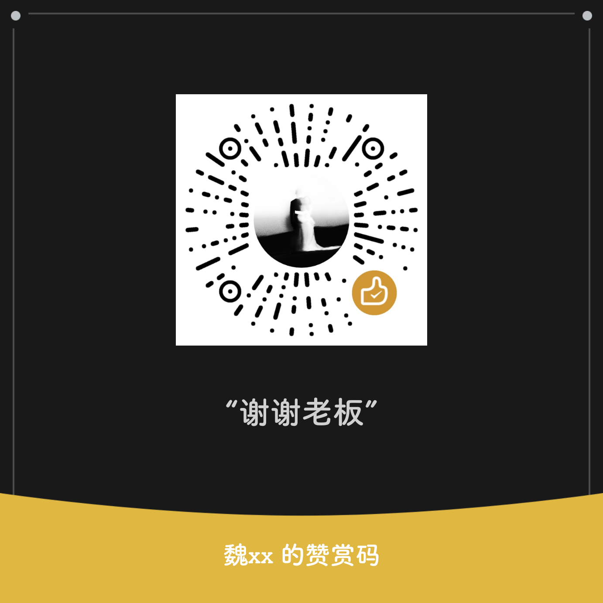

# TaplusBridge

当前正式版：**0.15.50 / 82** · [下载 APK](https://github.com/yudigaga/TaplusBridge/releases/latest) · [更新说明](docs/release-notes-0.15.50-release.md)

基于 libxposed API 102 的传送门增强模块。把识别到的链接交给规则指定的应用，提供长按识别、四方向拖动、翻译和 Google Lens 识图，支持通过 Root 或 Shizuku 解冻目标应用。

支持的传送门宿主：`com.miui.contentextension` **4.1.3 / 40013**、**5.1.5 / 50015**。模块最低 Android 9；系统截图兜底要求 Android 13+，相关系统手势限主用户、主显示器。其他宿主版本需单独适配。

## 快速开始

1. 安装 Release APK，在支持 API 102 的 LSPosed 中启用模块，勾选「传送门／内容扩展」和「系统框架」，然后重启。
2. 打开模块，确认「概览 → 运行与授权」显示「系统已确认配置」。在「应用」页设置允许触发的来源应用并保存。
3. 在「规则」页添加目标应用及域名、网址或协议规则；磁力填 `magnet:`，电驴填 `ed2k:`。按需在「运行与授权」选择并授权 Root 或 Shizuku。
4. 长按内容进行识别，点击目标卡片打开。需要方向动作时，在「识别 → 长按与拖动」启用并配置，点击「保存手势」。

默认浏览器、替换翻译、识别通道、截图与补点在「识别」页设置。**接管来源应用的原生选字工具条，还需在 LSPosed 中额外勾选该来源应用，并结束后重新启动它**；普通宿主识别和方向拖动不需添加来源作用域。具体覆盖范围见[使用指南](docs/usage.md)。

## 主要功能

- **链接流转**：按域名、协议和来源规则选择目标，支持网页、磁力、ed2k、剪贴板多链接选择与按目标分组；115 批量离线入口由用户确认提交。
- **识别与取链**：可分别设置原生文字与卡片、页面结构、OCR、服务端推荐、分词和剪贴板。可选截图兜底及松手后的补点取链，保留原文、图片与真实链接。
- **四方向拖动**：为上、下、左、右设置菜单、分享、浏览器、规则打开、识图、翻译、复制或不执行；支持自选分享目标和排序。
- **浏览器与翻译**：指定默认浏览器；翻译沿用宿主、使用本机应用或配置 AI 服务。可选接管符合条件的来源原生选字工具条。
- **Google Lens**：点击识图后上传选中图片，在模块结果页查看和切换模式，复用本轮图片会话。
- **按需运行**：本体与 Lens 进程空闲约 3 秒退出；模块保持启用，系统与宿主中的必要 Hook 继续监听。

0.15.50 在本轮已有有效链接且 OCR、分词满足完成条件时，减少等待在线附加推荐造成的动作延迟；没有有效链接的卡片仍保留必要等待。累计变化及验证范围见[本版更新说明](docs/release-notes-0.15.50-release.md)。

## 使用与文档

- [使用指南](docs/usage.md)：设置保存、来源名单、三段计时、补点、浏览器、选字工具条、翻译与 Lens。
- [文档索引](docs/README.md)：当前指南、本版技术记录及历史版本记录。
- [0.15.50 构建与发布验证](docs/2026-11-13-release-0.15.50.md)：签名、R8、对齐和测试证据。

隐藏桌面图标后，可从 **LSPosed → TaplusBridge → 模块设置**重新进入，在「概览 → 运行与授权」恢复图标。隐藏图标不关闭模块。

## 构建与验证

需要 JDK 21、Android SDK 37 和 Gradle Wrapper。Release 签名使用本机 `keystore.properties`，配置 `storeFile`、`storePassword`、`keyAlias`、`keyPassword`；密钥及签名属性不提交到仓库。

```powershell
.\gradlew.bat :app:testDebugUnitTest :app:lintRelease :app:assembleRelease
python -m unittest discover -s tools -p 'test_*.py'
python -m unittest discover -s tools/tests -p 'test_*.py'
```

Linux 使用 `bash ./gradlew`。Release 启用 R8 裁剪、优化和混淆，交付时应归档对应的 `mapping.txt`。GitHub Actions 执行 Android 单元测试、Release lint 和两组 Python 检查，不需要正式签名密钥。

本地测试、静态宿主契约和 CI 均不能代替手机上的 LSPosed 回调、ROM 窗口与手势、Root／Shizuku、Google 网络及目标应用服务验收；不保证所有应用的隐藏链接或自绘菜单都可接管。

## 赞助

如果喜欢这个项目，欢迎请我喝杯咖啡 ☕

<a href="https://raw.githubusercontent.com/yudigaga/TaplusBridge/main/docs/assets/wechat-sponsor.png">
  
</a>
